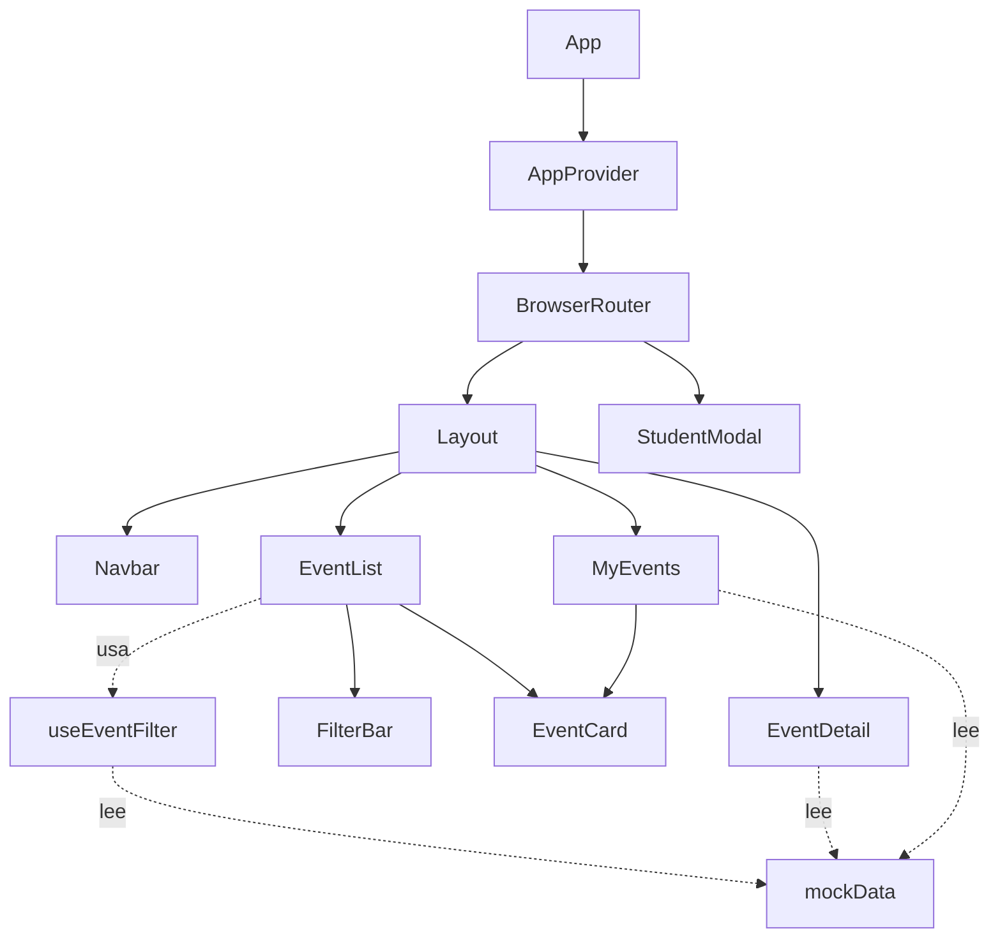

# EventosFISI — Eventos Académicos

Aplicación web (SPA) para que los estudiantes exploren los eventos académicos del mes, consulten su detalle y gestionen sus inscripciones.

Es un proyecto **solo frontend**: los eventos se cargan desde datos de prueba locales y la información del estudiante se guarda en el navegador (`localStorage`). No requiere backend ni base de datos.

## Tecnologías

| Herramienta | Uso |
|---|---|
| [React 19](https://react.dev) | Interfaz de usuario basada en componentes |
| [React Router 7](https://reactrouter.com) | Navegación entre vistas (SPA) |
| [Vite 8](https://vite.dev) | Servidor de desarrollo y empaquetado |
| CSS plano | Estilos globales en `src/index.css` |

## Funcionalidades

### Eventos del mes (`/`)
- Grilla de tarjetas con categoría, costo, fecha, hora, expositor, lugar y barra de cupos.
- Contadores de eventos **próximos** y **realizados**.
- **Filtros combinables:**
  - búsqueda por título, expositor o categoría;
  - categoría (Tecnología, Ciencias, Negocios, Humanidades, Salud, Arte y Cultura);
  - estado (todos, próximos, realizados);
  - costo (todos, gratuitos, de pago);
  - botón para limpiar los filtros activos.
- Inscripción directa desde la tarjeta. El botón se deshabilita si no quedan cupos.

### Detalle del evento (`/eventos/:id`)
- Descripción completa y **agenda** por sesiones.
- Panel lateral con fecha, hora, lugar, expositor (con su biografía), costo y ocupación.
- Inscripción o cancelación de la inscripción.
- Mensaje de "Evento no encontrado" si el ID no existe.

### Mis eventos (`/mis-eventos`)
- Lista de los eventos en los que el estudiante está inscrito, separada en pestañas **Próximos** y **Asistidos**.
- Cancelación de inscripciones de eventos que aún no se realizan.
- Contador de inscripciones en la barra de navegación.

### Identificación del estudiante
- Modal con nombre, correo institucional y teléfono.
- Validaciones:
  - nombre de 3 caracteres como mínimo;
  - correo `@unmsm.edu.pe` o `@universidad.edu.pe`;
  - teléfono de 7 a 15 dígitos.
- Si un estudiante no identificado intenta inscribirse, se abre el modal y, al guardar sus datos, queda inscrito automáticamente en ese evento.
- Desde la barra de navegación se pueden editar los datos o borrarlos del dispositivo. Al borrarlos también se eliminan las inscripciones.

> Las fechas pasadas se calculan comparando con la fecha actual del sistema. Un evento pasado no admite inscripciones.

## Arquitectura

```
src/
├── main.jsx              # Punto de entrada: monta <App /> en #root
├── App.jsx               # Proveedor de contexto + definición de rutas
├── index.css             # Estilos globales
├── context/
│   └── AppContext.jsx    # Estado global: estudiante, inscripciones y modal
├── hooks/
│   └── useEventFilter.js # Lógica de filtrado de eventos
├── pages/                # Vistas asociadas a una ruta
│   ├── EventList.jsx
│   ├── EventDetail.jsx
│   └── MyEvents.jsx
├── components/           # Componentes reutilizables
│   ├── Layout.jsx        # Navbar + <Outlet /> para las páginas
│   ├── Navbar.jsx
│   ├── EventCard.jsx
│   ├── FilterBar.jsx
│   └── StudentModal.jsx
├── data/
│   └── mockData.js       # Eventos y categorías de prueba
└── utils/
    └── dateUtils.js      # Formato de fechas/horas (locale es-PE)
```

### Flujo de componentes



### Decisiones principales

- **Estado global con Context API.** `AppContext` centraliza el perfil del estudiante, la lista de IDs de eventos inscritos y el estado del modal. Los componentes acceden a él con el hook `useApp()`, que lanza un error si se usa fuera de `<AppProvider>`.
- **Persistencia en `localStorage`.** Se usan las claves `edu_student` y `edu_inscriptions`. El estado se inicializa de forma perezosa leyendo esas claves, así que los datos se mantienen al recargar la página.
- **Lógica separada de la vista.** El filtrado vive en el hook `useEventFilter` (memoizado con `useMemo`), y `FilterBar` solo recibe el estado y los *setters* por props.
- **Layout con rutas anidadas.** `Layout` comparte la barra de navegación entre todas las páginas mediante `<Outlet />`. Cualquier ruta desconocida redirige a `/`.
- **Modal global.** `StudentModal` se renderiza una sola vez fuera de las rutas y se abre desde cualquier parte con `openModal(eventId?)`. Si recibe un `eventId`, la inscripción a ese evento queda pendiente hasta que el estudiante confirme sus datos.
- **Datos simulados.** `mockData.js` reemplaza a una API. Para conectar un backend real bastaría con sustituir las lecturas de `mockEvents` por llamadas HTTP.

## Cómo ejecutar el proyecto

Requisitos: **Node.js 20.19+ o 22.12+** y npm.

```bash
npm install      # instalar dependencias (solo la primera vez)
npm run dev      # servidor de desarrollo en http://localhost:5173
```

Otros scripts:

```bash
npm run build    # genera la versión de producción en dist/
npm run preview  # sirve localmente la versión de producción
```

## Datos de prueba

Los eventos se definen en [`src/data/mockData.js`](src/data/mockData.js). Cada evento tiene esta forma:

```js
{
  id: 1,
  title: 'Introducción a la Inteligencia Artificial',
  description: '...',
  date: '2026-10-03',        // YYYY-MM-DD
  time: '10:00',             // HH:mm
  speaker: 'Dr. Carlos Mendoza',
  speakerBio: '...',
  category: 'Tecnología',    // una de CATEGORIES
  isFree: true,
  cost: 0,                   // en soles (S/)
  capacity: 100,
  enrolled: 98,              // inscritos previos (simulados)
  location: 'Auditorio Principal — Pabellón A',
  agenda: [{ session: 'Sesión 1', time: '10:00', topic: '...' }],
}
```

Para identificarte en la aplicación usa cualquier correo que termine en `@unmsm.edu.pe`, por ejemplo `u202100001@unmsm.edu.pe`.
